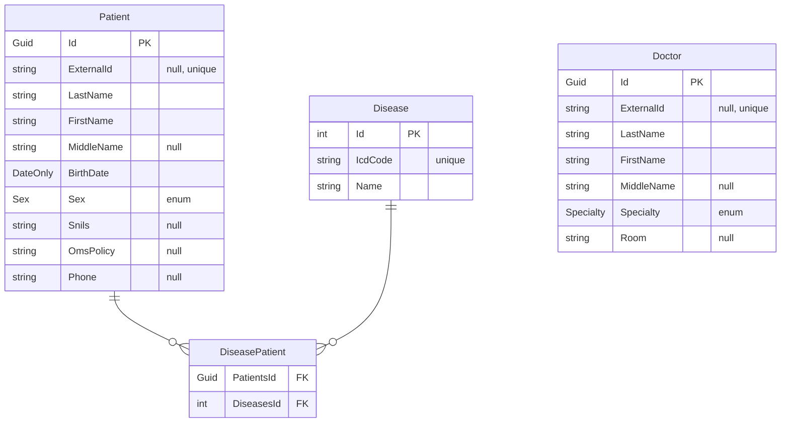

# Mis — мини-проект медицинской информационной системы

Данные в сидах синтетические.

## Схема



`DiseasePatient` генерирует EF Core из навигаций `Patient.Diseases` и `Disease.Patients`.

`Sex`: `Unknown`, `Male`, `Female`

`Specialty`: `Therapist`, `Cardiologist`, `Neurologist`, `Surgeon`, `Pediatrician`, `Ophthalmologist`

## Запросы

| Метод | Путь | Коды |
|---|---|---|
| `GET` | `/api/patients` | `200` |
| `GET` | `/api/patients/{id}` | `200`, `404` |
| `GET` | `/api/doctors` | `200`, `400` |
| `GET` | `/api/diseases` | `200` |

### GET /api/patients

```json
[
  {
    "id": "0d5f8a21-6c3e-4f0b-9a7d-11c2e5b4a890",
    "lastName": "Соколов",
    "firstName": "Артём",
    "middleName": "Игоревич",
    "birthDate": "1987-03-14",
    "sex": "Male"
  }
]
```

### GET /api/patients/{id}

```json
{
  "id": "0d5f8a21-6c3e-4f0b-9a7d-11c2e5b4a890",
  "externalId": "MIS-00412",
  "lastName": "Соколов",
  "firstName": "Артём",
  "middleName": "Игоревич",
  "birthDate": "1987-03-14",
  "sex": "Male",
  "snils": "000-000-000 00",
  "omsPolicy": "0000000000000000",
  "phone": "+7 900 000-00-00",
  "diseases": [
    { "id": 3, "icdCode": "E11.9", "name": "Сахарный диабет 2 типа" }
  ]
}
```

### GET /api/doctors

Фильтр `?specialty=Cardiologist`, без параметра — все врачи.

```json
[
  {
    "id": "5b2c9d44-8e71-4a36-bf02-7d9c1e4a3b55",
    "lastName": "Нечаева",
    "firstName": "Ольга",
    "middleName": "Владимировна",
    "specialty": "Cardiologist",
    "room": "214"
  }
]
```

### GET /api/diseases

```json
[
  { "id": 3, "icdCode": "E11.9", "name": "Сахарный диабет 2 типа" },
  { "id": 7, "icdCode": "I10",   "name": "Эссенциальная гипертензия" }
]
```
